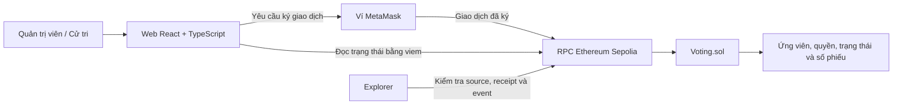
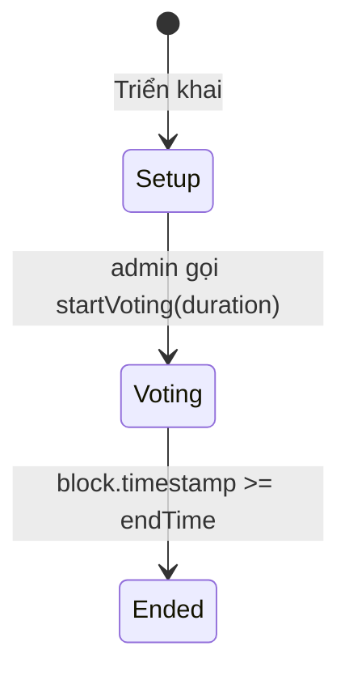

# Đề P CSE465: Phân tích yêu cầu và kế hoạch triển khai bằng Solidity

Ngày lập kế hoạch: 29/10/2026. Trạng thái: thiết kế và kế hoạch, chưa viết hợp đồng, chưa chạy kiểm thử, chưa triển khai Sepolia.

Nguồn đề bài: [BAI-TAP-LON-MON-CSE465.pdf](C:/Users/mrdoanh/Downloads/BAI-TAP-LON-MON-CSE465.pdf), đã đọc toàn bộ 9 trang và kiểm tra trực quan trang 5, 8, 9. Các yêu cầu học phần dưới đây được lấy từ tài liệu; lựa chọn nghiệp vụ, công nghệ, lịch làm việc và tiêu chí kỹ thuật là đề xuất để thực hiện đề P, không phải tiêu chí chấm điểm do giảng viên công bố.

## 1. Kết luận và hướng thực hiện

Nên chọn đề tài cụ thể: **Xây dựng hệ thống bầu chọn lớp trưởng bằng hợp đồng thông minh Solidity trên Ethereum Sepolia**.

Sản phẩm gồm một hợp đồng `Voting.sol`, bộ kiểm thử tự động, kịch bản triển khai và minh chứng giao dịch Sepolia. Bổ sung giao diện web nhỏ để kết nối ví, bỏ phiếu và xem kết quả. Viết báo cáo đúng bốn phần của đề, đồng thời chuẩn bị để từng thành viên giải thích được toàn bộ luồng giao dịch.

Phạm vi phù hợp là một cuộc bầu chọn cho mỗi địa chỉ hợp đồng, phiếu công khai, danh sách ví được cấp quyền, mỗi ví một phiếu có trọng số bằng nhau. Cách này đủ thể hiện các nội dung chính của môn: ví và chữ ký, giao dịch, trạng thái hợp đồng, EVM, gas, tính kiểm chứng và giới hạn của blockchain.

Ưu tiên hoàn thành hợp đồng đúng và có bằng chứng chạy thật trên Sepolia trước khi đầu tư giao diện hay chức năng nâng cao. Không cần xây blockchain riêng, token riêng hoặc cơ chế đồng thuận riêng cho đề P.

## 2. Đề thực sự yêu cầu gì?

### 2.1. Yêu cầu trực tiếp, có căn cứ từ PDF

**Trang 5, đề P:** “Viết hợp đồng thông minh ‘voting system’ và triển khai trên testnet Sepolia.” Đề thuộc nhóm B, mức trung bình, điểm tối đa **9,5**. Đây là mức trần được ghi trong tài liệu, không phải điểm được bảo đảm khi hoàn thành chức năng.

Từ câu đề có hai đầu việc không thể bỏ:

1. Có hợp đồng thông minh thực hiện chức năng bỏ phiếu. Trang web chỉ đếm phiếu bằng JavaScript hoặc cơ sở dữ liệu không đáp ứng phần này.
2. Triển khai hợp đồng trên **Ethereum Sepolia** và chứng minh được địa chỉ hợp đồng cùng giao dịch triển khai. Chạy trên Remix VM hoặc mạng local chưa hoàn tất yêu cầu mạng triển khai.

Ngôn ngữ Solidity là lựa chọn theo yêu cầu của người thực hiện trong cuộc trao đổi này; câu đề trong PDF không chỉ định ngôn ngữ.

**Trang 8, tổ chức nhóm:** mặc định 4 thành viên; có thể 3 hoặc 5 trong một số trường hợp. Thành viên bỏ học không làm thay đổi nhóm. Điểm quá trình chung cho nhóm, điểm cuối kỳ riêng từng người; cùng nhóm có thể có kết quả rất khác nhau. Hệ quả thực tế: phải phân công công việc nhưng không chia kiến thức thành các phần mà chỉ một người hiểu.

**Trang 9, quyển báo cáo:** bốn phần là Đặt vấn đề, Cơ sở lý thuyết, Triển khai, Kết luận; không quá 40 trang và nộp bản cứng. Phần triển khai cần nêu cấu trúc mã, phần mã chính và kết quả; kết luận cần có giá trị thu được, hạn chế và khả năng mở rộng.

### 2.2. Những điểm PDF chưa quy định

Tài liệu không đưa ra: hạn nộp, thời lượng demo, thang điểm thành phần, yêu cầu giao diện, số cuộc bầu chọn, quy tắc cấp quyền, phiếu kín hay công khai, ủy quyền, tỷ lệ tham gia tối thiểu, cách xử lý hòa, yêu cầu nộp repository/video hoặc bắt buộc verify source code.

Vì vậy, kế hoạch dưới đây dùng các giả định rõ ràng: nhóm 4 người, 4 tuần, demo quy mô nhỏ, bỏ phiếu công khai, một địa chỉ được cấp quyền có một phiếu. Khi có thông báo riêng của giảng viên, cập nhật giả định; không coi phần đề xuất thành yêu cầu có sẵn trong đề.

## 3. Đặc tả nghiệp vụ được đề xuất

### 3.1. Bối cảnh và các vai trò

Một lớp muốn bầu một lớp trưởng trong danh sách ứng viên được công bố trước. Ban tổ chức đối chiếu danh sách thành viên ngoài blockchain và đăng ký địa chỉ ví của người đủ điều kiện. Cử tri bỏ phiếu bằng giao dịch ký từ ví của mình. Bất kỳ ai cũng có thể kiểm tra số phiếu và trạng thái trên blockchain.

- **Quản trị viên:** địa chỉ triển khai hợp đồng; thêm ứng viên, cấp quyền cho cử tri, bắt đầu cuộc bầu chọn. Quản trị viên chỉ được bỏ phiếu nếu cũng được đăng ký làm cử tri.
- **Cử tri:** ví đã được đăng ký; được chọn đúng một ứng viên trong thời gian cho phép.
- **Người quan sát:** đọc thông tin và kết quả, không cần quyền quản trị hay quyền bỏ phiếu.

Quản trị viên có quyền lựa chọn danh sách đầu vào. Blockchain kiểm tra việc thực hiện quy tắc sau đó; không tự xác nhận danh tính thật hoặc sự công bằng của danh sách ban đầu.

### 3.2. Mười hai quy tắc cần chốt trước khi code

1. Một hợp đồng tương ứng một cuộc bầu chọn. Cuộc bầu chọn mới dùng hợp đồng mới, không reset kết quả cũ.
2. Mỗi cử tri được cấp một phiếu, trọng số 1; không phụ thuộc số ETH hay token.
3. Chỉ quản trị viên được thêm ứng viên và đăng ký cử tri trong giai đoạn chuẩn bị.
4. Trước khi bắt đầu phải có ít nhất 2 ứng viên và ít nhất 1 cử tri.
5. Bắt đầu một lần; khi bắt đầu khóa danh sách ứng viên, danh sách cử tri và thời hạn.
6. Cuộc bỏ phiếu mở ngay tại block chứa giao dịch bắt đầu thành công. Thời hạn tính bằng timestamp blockchain, không theo đồng hồ trình duyệt.
7. Phiếu hợp lệ chỉ khi `startTime <= block.timestamp < endTime`. Tại đúng `endTime`, phải từ chối.
8. Cử tri chỉ được bỏ một lần, không được đổi hoặc rút phiếu trong phiên bản cơ bản.
9. Ứng viên được chọn phải tồn tại. Giao dịch không hợp lệ không được làm thay đổi số phiếu hay đánh dấu cử tri đã bỏ.
10. Khi hết hạn, tất cả các địa chỉ, kể cả quản trị viên, đều không thể thêm phiếu hoặc sửa kết quả.
11. Có một ứng viên đạt số phiếu cao nhất và tổng phiếu lớn hơn 0 thì ứng viên đó thắng. Nếu nhiều ứng viên đồng hạng cao nhất thì trả về hòa; nếu không có phiếu thì trả về không có kết quả thắng.
12. Phiếu và số đếm công khai. Trong thời gian bỏ phiếu, kết quả hiển thị là tạm thời; chỉ sau khi hết hạn mới công bố kết quả cuối cùng theo quy tắc trên.

Không đặt tỷ lệ tham gia tối thiểu trong bản đầu. Nếu chỉ có một phiếu hợp lệ, vẫn xét kết quả theo quy tắc đã công bố. Muốn bổ sung quorum phải sửa đặc tả, test và phần trình bày trước khi lập trình.

### 3.3. Phân tầng phạm vi

**Phần bắt buộc theo đề:** hợp đồng bỏ phiếu và triển khai Sepolia; tuân thủ yêu cầu nhóm và quyển báo cáo.

**Phần lõi kỹ thuật được đề xuất:** phân quyền, danh sách ứng viên, danh sách cử tri, một ví một phiếu, kiểm soát thời gian, kiểm phiếu, xử lý hòa/không có phiếu, event, kiểm thử và script tái lập triển khai. Đây là cách cụ thể hóa “voting system” thành sản phẩm có thể kiểm chứng.

**Phần nên có để demo và đánh giá rõ:** giao diện web, verify source trên explorer, liên kết giao dịch, đo gas, sơ đồ kiến trúc và bộ minh chứng. Các phần này không được ghi là bắt buộc trong PDF.

**Chỉ làm sau khi bản lõi ổn định:** nhiều cuộc bầu chọn qua factory, allowlist Merkle cho quy mô lớn, hỗ trợ nhiều ví kết nối, xuất kết quả, nghiên cứu commit–reveal.

Không đưa NFT, ERC-20, đăng nhập bằng mật khẩu, backend quản lý phiếu, proxy nâng cấp, ZK voting hoặc bỏ phiếu có trọng số vào bản đầu. Những phần đó làm tăng việc phải giải thích và kiểm thử nhưng chưa cần để đáp ứng đề.

## 4. Kiến trúc và công nghệ

### 4.1. Luồng hệ thống



Smart contract là nơi thực thi quy tắc và lưu kết quả. Frontend chịu trách nhiệm trình bày, kiểm tra đầu vào để hỗ trợ người dùng, và yêu cầu ví ký giao dịch. Việc ẩn nút trên frontend không thay thế kiểm tra quyền trong hợp đồng. Explorer hỗ trợ kiểm chứng độc lập; kết quả không phụ thuộc máy chủ riêng của nhóm.

Không cần backend hay database cho MVP. Tên ứng viên, mã ứng viên, địa chỉ ví và số phiếu được lưu on-chain; ảnh minh họa, nội dung giải thích và tài liệu để ngoài blockchain. Chỉ dùng dữ liệu thử nghiệm, không đưa danh sách sinh viên kèm mã số/thông tin riêng tư lên chain. Hồ sơ đối chiếu người–ví, nếu có, thuộc quy trình ngoài chain.

### 4.2. Bộ công cụ được chọn

- **Solidity 0.8.x bản ổn định:** chọn một phiên bản compiler cụ thể lúc khởi tạo, ghim trong cấu hình và ghi lại; không dùng bản `develop` chỉ vì tài liệu `/latest` hiển thị nó.
- **Hardhat 3:** compile, test, chạy mạng local và cấu hình Sepolia. Khởi tạo từ template TypeScript + Node test runner + viem để giữ cùng hệ công cụ.
- **Node.js thuộc dòng được Hardhat hỗ trợ:** tài liệu khởi tạo ghi tối thiểu 22.13.0; chốt một bản LTS tương thích, lưu phiên bản trong README. Không diễn giải rằng mọi bản Node lớn hơn mức tối thiểu đều được hỗ trợ.
- **Hardhat Ignition:** mô tả deployment và lưu dữ liệu triển khai có thể tái lập.
- **React + TypeScript + Vite + viem:** giao diện đơn giản; dùng viem để đọc hợp đồng, mô phỏng lời gọi, gửi giao dịch qua ví và chờ receipt.
- **MetaMask:** ví demo của quản trị viên và cử tri; mỗi tài khoản là một vai trò kiểm thử.
- **Ethereum Sepolia:** chain ID `11155111`; dùng ETH thử nghiệm cho gas. Không nhầm với Base Sepolia hoặc Arbitrum Sepolia.
- **Git và lockfile:** lưu lịch sử đóng góp, ghim dependencies và tái lập môi trường.

Hardhat cung cấp template viem và quy trình khởi tạo chính thức tại [Getting started](https://hardhat.org/docs/getting-started); kiểm tra dòng Node được hỗ trợ tại [Node.js support](https://hardhat.org/docs/reference/nodejs-support). Ethereum mô tả Sepolia là testnet cho ứng dụng tại [Networks](https://ethereum.org/developers/docs/networks/); chain ID được ghi trong [Sepolia metadata](https://github.com/eth-clients/sepolia/blob/main/README.md#meta-data-sepolia).

Remix có thể dùng để học cú pháp hoặc thao tác dự phòng, nhưng bộ test và quy trình triển khai chính nên được lưu trong project. Nếu dùng thư viện bên ngoài, chọn phiên bản tương thích compiler và dẫn nguồn; không thêm thư viện chỉ để tăng số công nghệ.

### 4.3. Cấu trúc thư mục dự kiến

Đây là cấu trúc sẽ triển khai, chưa phải các tệp đã tồn tại:

```text
BlockChain/
  contracts/
    Voting.sol
  test/
    Voting.ts
    Voting.invariants.ts
  ignition/modules/
    Voting.ts
  scripts/
    seed-election.ts
    export-deployment.ts
    smoke-sepolia.ts
  frontend/
    src/
      components/
      lib/
      generated/           # ABI và địa chỉ xuất từ deployment
  deployments/
    sepolia.json           # metadata công khai, không có private key
  docs/
    KE-HOACH-DE-P-SOLIDITY.md
    requirements.md
    test-results.md
    demo-script.md
    report/
    evidence/
  hardhat.config.ts
  package.json
  .gitignore
  README.md
```

## 5. Thiết kế Solidity chi tiết

### 5.1. Dữ liệu và ý nghĩa

Một hợp đồng `Voting` gồm:

- `address public immutable admin`: chủ thể quản trị cố định từ lúc triển khai; kiểm tra bằng `msg.sender`.
- `string public electionTitle`: tên cuộc bầu chọn, đặt trong constructor và không có hàm sửa.
- `Candidate[] candidates`: mỗi phần tử chứa `name` và `voteCount`; vị trí mảng là candidate ID, bắt đầu từ 0.
- `mapping(bytes32 => bool) candidateNameUsed`: chống trùng chính xác theo hash của chuỗi tên đã nhập.
- `mapping(address => bool) isRegistered`: địa chỉ được cấp quyền.
- `mapping(address => bool) hasVoted`: địa chỉ đã bỏ phiếu thành công.
- `uint256 public registeredVoterCount`, `uint256 public totalVotes`: số ví đã đăng ký và số phiếu hợp lệ.
- `bool public started`, `uint256 public startTime`, `uint256 public endTime`: thông tin vòng đời.
- `enum Phase { Setup, Voting, Ended }`: trạng thái được tính từ `started` và thời gian hiện tại.
- `enum Outcome { NoVotes, Winner, Tie }`: phân biệt kết quả cuối cùng; chưa hết giờ thì hàm kết quả cuối cùng revert.

Không nhất thiết lưu thêm `voterChoice`: `VoteCast` và dữ liệu giao dịch đã cho phép truy vết phiếu công khai. Nếu bổ sung biến đó để đọc thuận tiện, cần giải thích chi phí lưu trữ và mặc định 0 không đồng nghĩa đã chọn ứng viên 0; phải kiểm tra `hasVoted`.

Các giới hạn dự kiến: tối đa 20 ứng viên, tên ứng viên 1–96 byte, tiêu đề 1–160 byte, một batch đăng ký 1–100 địa chỉ, thời lượng bỏ phiếu 60 giây–30 ngày. Đây là tham số thiết kế để giới hạn vòng lặp và hỗ trợ demo, cần đo gas để điều chỉnh trước khi chốt bản cuối. Độ dài `bytes(text).length` là byte UTF-8, không phải số ký tự tiếng Việt.

Frontend chuẩn hóa khoảng trắng và Unicode cho tên; hợp đồng bảo đảm không rỗng, không quá dài và không trùng byte chính xác. Không tuyên bố hợp đồng hiểu hai tên khác cách viết nhưng cùng chỉ một người. ID ứng viên mới là định danh kỹ thuật.

### 5.2. Vòng đời không cần người đóng phiếu



Quy tắc `phase()`:

```text
nếu started == false: Setup
nếu started == true và block.timestamp < endTime: Voting
còn lại: Ended
```

Mũi tên hết hạn là thay đổi kết quả tính toán khi được đọc/thực thi ở timestamp mới, không phải blockchain tự gửi giao dịch hoặc tự phát event. Không cần `endVoting()` hoặc `finalize()` để chặn phiếu sau hạn. Kết quả được tính từ số đếm đã không thể thay đổi. Frontend phải cập nhật theo block/poll và đọc lại `phase()`.

Không cung cấp nút gia hạn, đóng sớm, sửa danh sách sau khi bắt đầu hoặc reset. Quyết định này giảm quyền can thiệp của quản trị viên sau khi khóa cấu hình. Nếu phát hiện cấu hình sai trước khi bắt đầu, bản MVP có thể triển khai lại; phải ghi rõ địa chỉ mới và coi địa chỉ cũ là không sử dụng.

### 5.3. Giao diện hàm dự kiến

Các chữ ký dưới đây là đặc tả API, không phải hợp đồng hoàn chỉnh có thể deploy:

```solidity
constructor(string memory title);

function addCandidate(string calldata name) external;
function registerVoters(address[] calldata voters) external;
function startVoting(uint256 durationSeconds) external;
function vote(uint256 candidateId) external;

function phase() public view returns (Phase);
function candidateCount() external view returns (uint256);
function getCandidate(uint256 candidateId)
    external view returns (string memory name, uint256 voteCount);
function getResults()
    external view returns (uint256[] memory voteCounts, uint256 total);
function getOutcome()
    external view returns (Outcome outcome, uint256[] memory winnerIds,
                           uint256 highestVotes);
```

`addCandidate`: chỉ admin, chỉ Setup; kiểm tra giới hạn số lượng, độ dài, trùng tên; thêm phần tử và phát event.

`registerVoters`: chỉ admin, chỉ Setup; batch nằm trong giới hạn, không có địa chỉ 0, không trùng địa chỉ đã đăng ký hoặc trùng ngay trong batch. Nếu một mục không hợp lệ, revert toàn bộ batch để kết quả rõ ràng. Không có hàm thu hồi quyền trong MVP. Frontend/script cần lọc trùng trước khi gửi nhưng contract vẫn tự kiểm tra.

`startVoting`: chỉ admin, chỉ Setup; kiểm tra số ứng viên, cử tri, duration; đặt `started = true`, `startTime = block.timestamp`, `endTime = startTime + durationSeconds`. Sau đó không đổi các giá trị này.

`vote`: chỉ nhận phiếu trong Voting, từ địa chỉ đã đăng ký, chưa bỏ phiếu, với candidate ID hợp lệ. Tất cả kiểm tra hoàn tất trước khi cập nhật dữ liệu.

```text
vote(candidateId):
    kiểm tra phase() == Voting
    kiểm tra isRegistered[msg.sender]
    kiểm tra !hasVoted[msg.sender]
    kiểm tra candidateId < candidates.length

    hasVoted[msg.sender] = true
    candidates[candidateId].voteCount += 1
    totalVotes += 1
    phát VoteCast(msg.sender, candidateId)
```

Hàm bỏ phiếu không gọi hợp đồng ngoài và không chuyển ETH. Dùng hàm nonpayable; người dùng trả gas cho mạng, không trả một khoản phí bỏ phiếu vào hợp đồng. Không dùng `tx.origin` để xác thực quyền.

`getResults`: đọc số phiếu ở mọi giai đoạn; trong Voting phải hiển thị nhãn “kết quả tạm thời”.

`getOutcome`: chỉ sau Ended. Nếu `totalVotes == 0`, trả `NoVotes`, mảng ID rỗng và 0. Nếu có phiếu, tìm số lớn nhất và trả tất cả ID đạt số đó: một ID là `Winner`, nhiều ID là `Tie`. Không chọn phần tử đầu tiên làm người thắng khi hòa. Duyệt tối đa 20 ứng viên nên chi phí đọc có giới hạn.

### 5.4. Event và lỗi

Event dự kiến:

- `CandidateAdded(uint256 indexed candidateId, string name)`.
- `VoterRegistered(address indexed voter)`.
- `VotingStarted(uint256 startTime, uint256 endTime)`.
- `VoteCast(address indexed voter, uint256 indexed candidateId)`.

Không thêm `VotingEnded` nếu không có giao dịch nào phát nó. Event giúp kiểm tra lịch sử; state là nơi đọc số đếm hiện tại. Bản demo công khai nên event ghi địa chỉ và lựa chọn là nhất quán với phạm vi đã công bố.

Custom errors nên thể hiện rõ: `Unauthorized`, `InvalidPhase`, `InvalidTitle`, `InvalidCandidateName`, `DuplicateCandidate`, `CandidateLimitReached`, `InvalidVoter`, `AlreadyRegistered`, `InvalidBatchSize`, `InsufficientCandidates`, `NoRegisteredVoters`, `InvalidDuration`, `NotRegistered`, `AlreadyVoted`, `InvalidCandidate`, `ResultsNotFinal`.

Frontend ánh xạ các lỗi này sang tiếng Việt; không cho người dùng chỉ thấy chuỗi lỗi RPC khó hiểu. Bộ test phải kiểm tra đúng lỗi và trạng thái không đổi sau revert.

## 6. Các giới hạn và thuộc tính cần giải thích khi bảo vệ

**Một địa chỉ không phải một người.** `hasVoted` ngăn một địa chỉ bỏ hai lần; không ngăn một cá nhân giữ nhiều ví đã được cấp quyền. Nhóm phải nói rõ quy trình xác minh/cấp quyền ngoài blockchain và giả định tin cậy vào ban tổ chức.

**Phiếu công khai, không cam kết ẩn danh.** `private` trong Solidity không làm dữ liệu trên blockchain trở thành bí mật. Giấu màn hình kết quả cũng không giấu calldata, storage hoặc event. Tài liệu Solidity nêu rõ giới hạn này tại [Security considerations](https://docs.soliditylang.org/en/latest/security-considerations.html#private-information-and-randomness). Vì vậy bản này phù hợp demo bầu chọn công khai, không nên mô tả là hệ thống bầu cử bí mật hoàn chỉnh.

**Kết quả trung gian có thể ảnh hưởng cử tri.** Chấp nhận đặc tính này trong phạm vi công khai. Nếu nghiên cứu commit–reveal, cần thêm hai giai đoạn, salt đủ mạnh, quy tắc không reveal và kiểm thử; commit–reveal không tự giải quyết danh tính, cưỡng ép hay mọi yêu cầu bảo mật lá phiếu.

**Thời điểm gửi không phải thời điểm hợp lệ.** Giao dịch được ký trước hạn nhưng chỉ được thực thi trong block sau hạn sẽ revert. Đồng hồ UI chỉ là hỗ trợ; thời gian chain và điều kiện contract mới quyết định. Demo cần khoảng thời gian đủ dư, không gửi ở giây cuối.

**Có hash chưa có nghĩa đã bỏ phiếu thành công.** Phải chờ receipt, kiểm tra trạng thái thành công rồi đọc lại `hasVoted` và số đếm. Phân biệt đang chờ ký, đã gửi, đang chờ xác nhận, thành công, bị từ chối ký và revert. Khi giao dịch bị thay thế hoặc ví đổi tài khoản, giao diện phải cập nhật đúng.

**Tính kiểm chứng có giới hạn thực tế.** Contract không có hàm sửa số phiếu và mạng xác thực các giao dịch, nhưng chất lượng hệ thống vẫn phụ thuộc code, khóa ví, danh sách được cấp quyền và hạ tầng truy cập. Receipt mới xác nhận giao dịch được đưa vào block; mức chắc chắn tăng theo xác nhận/finality của mạng, không nên diễn đạt thành tuyệt đối ngay khi nhận hash.

**Giới hạn gas:** tránh duyệt toàn bộ cử tri trong `vote()`. Dùng mapping để mỗi phiếu có số bước không tăng theo tổng số cử tri. Đăng ký theo batch nhỏ; truy vấn và kiểm phiếu theo danh sách ứng viên đã giới hạn. Batch giới hạn 100 là điểm khởi đầu để đo, không phải cam kết phù hợp mọi mạng/cấu hình.

**Khóa riêng:** ví ký ở phía người dùng; không đưa seed phrase/private key vào frontend, repository, ảnh báo cáo hoặc log. Sử dụng ví thử nghiệm riêng và cơ chế secret của môi trường phát triển. Không yêu cầu cử tri cung cấp khóa riêng cho admin.

## 7. Kế hoạch kiểm thử và nghiệm thu

### 7.1. Các nhóm kiểm thử bắt buộc cho bản thiết kế này

**T01–T04, khởi tạo:** admin và tiêu đề đúng; tiêu đề rỗng/quá dài bị từ chối; `Setup` ban đầu; số đếm và thời gian mặc định đúng.

**T05–T09, ứng viên:** admin thêm được; người khác không thêm được; tên rỗng/quá dài/trùng bị từ chối; giới hạn ứng viên; ID và event đúng. Kiểm tra thêm sau khi mở hoặc kết thúc đều thất bại.

**T10–T15, cử tri:** batch hợp lệ; người không phải admin; batch rỗng/quá lớn; địa chỉ 0; địa chỉ trùng trong batch hoặc đã tồn tại; tính nguyên tử khi một phần tử lỗi. Kiểm tra `registeredVoterCount` và không đăng ký được sau khi bắt đầu.

**T16–T20, bắt đầu:** đủ dữ liệu thì mở được; không phải admin bị chặn; thiếu ứng viên/cử tri bị chặn; duration ngoài giới hạn bị chặn; không mở lại hoặc sửa endTime.

**T21–T27, bỏ phiếu:** phiếu hợp lệ tăng đúng một ứng viên và tổng; chưa đăng ký bị chặn; bỏ trùng bị chặn; candidate ID không tồn tại bị chặn; trước mở bị chặn; tại/sau hạn bị chặn; admin chưa đăng ký cũng không được bỏ. Mỗi lần thất bại phải giữ nguyên dữ liệu.

**T28–T31, biên thời gian:** trong block bắt đầu, `endTime - 1`, đúng `endTime`, `endTime + 1`. Dùng cơ chế điều khiển timestamp/block của mạng local; không chờ thời gian thật hoặc cố thao túng thời gian Sepolia. Test tại biên nên đặt timestamp chính xác cho block chứa giao dịch.

**T32–T36, kết quả:** một người thắng; hòa hai người; hòa nhiều người; không có phiếu; gọi `getOutcome()` trước hạn bị chặn. Kết quả tạm thời vẫn đọc được và tổng khớp từng ứng viên.

**T37–T40, thuộc tính bất biến:** sinh các chuỗi hành động hợp lệ và không hợp lệ, đối chiếu với mô hình đếm độc lập để kiểm tra:

```text
tổng voteCount của các ứng viên == totalVotes
totalVotes <= registeredVoterCount
mỗi ví đăng ký có nhiều nhất một phiếu thành công
sau Ended, mọi số đếm và danh sách đều không đổi
```

Nếu gửi hai giao dịch bỏ phiếu từ cùng địa chỉ, tối đa một giao dịch được ghi nhận phiếu; không giả định request đồng thời có thể vượt `hasVoted`. Kiểm tra cả bỏ lại cùng ứng viên và đổi sang ứng viên khác.

**T41–T46, tích hợp UI:** kết nối/đổi ví; sai chain; không đủ gas; hủy ký; pending/thành công/revert; reload vẫn thấy kết quả on-chain. Cố tình gọi contract trực tiếp để chứng minh quy tắc không phụ thuộc frontend.

Các mã T là nhóm tình huống kiểm thử dự kiến, có thể tách thành nhiều test case; chưa phải số lượng test đã chạy hoặc đạt.

### 7.2. Dữ liệu demo và đối chiếu

Một cuộc bầu chọn có 3 ứng viên A/B/C, 5 ví được cấp quyền, một ví ngoài danh sách. Cả 5 ví hợp lệ bỏ phiếu tạo kết quả A=2, B=2, C=1; kết luận hòa A/B. Dùng một fixture/deployment riêng cho kết quả A=3, B=1, C=1 để chứng minh thắng duy nhất. Dùng fixture riêng cho không có phiếu; không sửa state cuộc bầu chọn thật để tạo thêm trường hợp.

Local có thể dùng nhiều tài khoản thử nghiệm; lên Sepolia chỉ cần một bộ giao dịch nhỏ nhưng đủ chứng minh luồng chính và kiểm tra quyền. Các trường hợp lỗi có thể minh chứng bằng test/mô phỏng lời gọi; không cần cố gửi mọi giao dịch chắc chắn revert để mất gas thử nghiệm.

### 7.3. Đánh giá gas và chất lượng

Đo gas của deploy, thêm ứng viên, đăng ký 1/10/50 ví và một phiếu hợp lệ. Ghi rõ compiler, optimizer, số ứng viên, loại lần ghi storage, nguồn đo local hay Sepolia. Phiếu đầu tiên và phiếu tiếp theo có thể có chi phí khác nhau; không chỉ lấy một lần đo rồi kết luận tổng quát.

Chi phí thực trả của giao dịch dùng receipt: `gasUsed × effectiveGasPrice`, sau đó đổi từ wei sang ETH. Báo cáo số gas và Sepolia ETH; không cần quy đổi thành tiền thật hoặc hứa một mức phí cố định.

Mục tiêu nội bộ: toàn bộ tình huống trọng yếu và nhánh phân quyền/thời gian phải được kiểm tra; báo cáo coverage thực đo nếu công cụ hỗ trợ. Không lấy phần trăm coverage cao thay thế bằng chứng đúng nghiệp vụ.

### 7.4. Điều kiện hoàn thành

- Compile và toàn bộ bộ test đã chốt chạy thành công trên môi trường sạch.
- Không có đường gọi nào cho phép bỏ trùng, bỏ sai thời gian hoặc sửa số phiếu bằng quyền admin.
- Có địa chỉ hợp đồng và receipt triển khai thành công trên Ethereum Sepolia.
- Có ít nhất một chu trình cấp quyền, mở phiếu, bỏ phiếu và đọc kết quả trên Sepolia; đối chiếu explorer với UI/script.
- ABI, địa chỉ và chain ID trong frontend đúng bản triển khai được ghi trong báo cáo.
- Có tài liệu chạy lại, minh chứng, báo cáo đúng cấu trúc/giới hạn và từng thành viên trình bày được phần lõi.

## 8. Quy trình triển khai lên Sepolia

1. **Khóa môi trường:** kiểm tra phiên bản Node, Hardhat, compiler và dependencies; lưu lockfile và cấu hình optimizer/EVM target. Chạy compile/test local.
2. **Chuẩn bị tài khoản:** ví deploy/admin, vài ví cử tri và một ví ngoài danh sách. Nhận Sepolia ETH từ faucet được liệt kê trong nguồn chính thức, kiểm tra điều kiện sử dụng và số dư. Mỗi ví gửi giao dịch đều cần gas, không chỉ admin.
3. **Cấu hình mạng:** đặt URL RPC Sepolia, chain ID `11155111`, tài khoản ký và thông tin verify theo cấu hình Hardhat đang dùng. Secret đặt trong keystore hoặc môi trường riêng. RPC key dùng ở frontend chỉ là key công khai có giới hạn origin/quota; không đưa secret triển khai vào biến frontend.
4. **Chạy deployment module:** constructor chỉ thiết lập tiêu đề và admin; sau triển khai hợp đồng còn ở Setup. Tách script seed để không làm cuộc bỏ phiếu tự bắt đầu trước buổi demo.
5. **Kiểm tra sau deploy:** receipt thành công, đúng mạng, `eth_getCode` có bytecode, getter admin/title/phase đúng. Lưu địa chỉ, transaction hash, block number, constructor arguments, compiler/settings và Git commit nếu project đã dùng Git.
6. **Verify source:** dùng đúng compiler, optimizer, EVM target, source và constructor arguments. Verify là đối chiếu source với bytecode, không phải chứng nhận hợp đồng an toàn.
7. **Seed và kiểm tra:** thêm ứng viên, đăng ký cử tri, đối chiếu state; sau đó mới bắt đầu với thời lượng phù hợp buổi demo.
8. **Xuất artifact frontend:** ABI và địa chỉ phải được sinh từ deployment đã xác nhận; kiểm tra network trước khi gửi vote.
9. **Chạy smoke test và lưu minh chứng:** bỏ phiếu thật, chờ receipt, kiểm tra event/state, ghi nhận kết quả sau hạn. Có bản ghi hoặc ảnh dự phòng khi RPC/faucet trục trặc.

Các lệnh dự kiến sau khi tạo đúng file và cấu hình:

```powershell
npx hardhat --init --template node-test-runner-viem
npx hardhat compile
npx hardhat test
npx hardhat ignition deploy ignition/modules/Voting.ts --network sepolia --verify
```

Lệnh khởi tạo dùng trong workspace dự án chưa được khởi tạo; không chạy lại một cách mù quáng trên project đã có cấu hình. `--verify` đòi hỏi plugin/cấu hình explorer phù hợp; có thể deploy trước rồi verify riêng. Trong phiên lập kế hoạch này chưa chạy các lệnh triển khai.

Tham khảo quy trình chính thức: [Hardhat Ignition deployment](https://hardhat.org/docs/guides/deployment/using-ignition), [Verifying contracts](https://hardhat.org/docs/guides/smart-contract-verification), [Configuration variables](https://hardhat.org/docs/tutorial/configuration-variables).

Không hardcode một thời điểm quá gần trong deployment module: mạng chậm có thể làm thời hạn trôi qua trước khi kịp demo. Thiết kế `startVoting(duration)` tách biệt giúp giảm rủi ro này.

## 9. Kế hoạch 4 tuần và phân công

### 9.1. Giả định và phụ thuộc

Lịch tương đối vì PDF chưa có deadline. Giả định 4 người, mỗi người khoảng 6–8 giờ/tuần trong 4 tuần, tương đương 96–128 giờ-người. Đây là ước lượng lập kế hoạch; mức quen thuộc với Solidity và frontend có thể làm thay đổi đáng kể.

Đường công việc chính: chốt quy tắc → contract + tests → triển khai Sepolia → tích hợp và minh chứng → báo cáo và tập bảo vệ. Giao diện có thể làm bố cục sớm nhưng tích hợp phải theo ABI đã thống nhất. Báo cáo lý thuyết và danh sách ca kiểm thử có thể chuẩn bị đồng thời.

### 9.2. Tuần 1: Hiểu bài toán, khóa thiết kế, có hợp đồng đầu tiên

- Ngày 1–2: đọc đề, thống nhất phạm vi, vẽ use case và vòng đời, chốt cách xử lý hòa/không phiếu, lập tiêu chí nghiệm thu.
- Ngày 3: khởi tạo Hardhat, cấu hình compiler cố định, tạo cấu trúc project và kiểm tra mẫu test chạy được.
- Ngày 4–5: triển khai dữ liệu, phân quyền, thêm ứng viên, cấp quyền và mở phiếu; viết test cùng các phần này.
- Chuẩn bị ví thử nghiệm và tìm nguồn Sepolia ETH sớm; có thể deploy một bản nháp để phát hiện lỗi hạ tầng, không dùng làm bản nộp cuối.
- **Đầu ra:** đặc tả 1–2 trang, API dự kiến thống nhất, project build được, các test phần Setup chạy được.

### 9.3. Tuần 2: Hoàn chỉnh contract và kiểm thử

- Hoàn thành `vote`, getters, outcome, events và custom errors.
- Kiểm thử quyền, phiếu trùng, dữ liệu lỗi, biên thời gian, hòa/không phiếu và các bất biến.
- Rà soát chéo: người không viết hàm kiểm tra lại điều kiện và test của hàm.
- Đo gas, kiểm tra vòng lặp và giới hạn batch; sửa đặc tả nếu số liệu yêu cầu.
- **Đầu ra:** contract ổn định trên local, báo cáo test sơ bộ, script deploy/seed và ABI đã chốt cho frontend.

### 9.4. Tuần 3: Sepolia và giao diện

- Deploy phiên bản dự kiến dùng cho nghiệm thu, verify và lưu metadata.
- Hoàn thành màn hình thông tin cuộc bầu chọn, quản trị Setup, bỏ phiếu và kết quả.
- Kết nối ví, kiểm tra chain, xử lý pending/revert/đổi tài khoản; đọc lại state sau receipt.
- Chạy luồng đủ bước trên Sepolia, thu hash, ảnh và gas thực đo.
- **Đầu ra:** một bản chạy xuyên suốt, dữ liệu UI khớp blockchain; người khác trong nhóm có thể chạy theo README.

### 9.5. Tuần 4: Hoàn thiện báo cáo và bảo vệ

- Ngày 1–2: bổ sung kết quả thực nghiệm vào báo cáo; giải thích đoạn code chính và các giới hạn.
- Ngày 3: diễn tập demo bằng ví và mạng thực; kiểm tra kịch bản khi mạng chậm.
- Ngày 4: mỗi người trả lời câu hỏi toàn hệ thống; sửa lỗi cuối, kiểm tra số trang và nguồn trích dẫn.
- Ngày 5: dự phòng, đóng gói mã nguồn và tài liệu, in báo cáo theo yêu cầu học phần.
- **Đầu ra:** bộ nộp bài hoàn chỉnh và demo có thể tái hiện.

### 9.6. Phân công nhóm 4 người

- **Thành viên A, contract:** mô hình dữ liệu, vòng đời, quyền, logic bỏ phiếu. Bàn giao code, giải thích quyết định và phối hợp sửa lỗi test.
- **Thành viên B, kiểm thử:** lập test cases từ đặc tả, test biên/bất biến, đo gas, kiểm tra lại logic A viết. Bàn giao kết quả có thể chạy lại.
- **Thành viên C, frontend:** ví, giao diện quản trị/cử tri/kết quả, trạng thái giao dịch, đồng bộ ABI và chain. Bàn giao luồng UI hoạt động và test tích hợp.
- **Thành viên D, triển khai và tích hợp tài liệu:** RPC, Ignition, verify, smoke test Sepolia, quản lý minh chứng và ghép báo cáo. Có đóng góp kỹ thuật thực tế, không chỉ làm Word.

Mỗi người viết phần báo cáo liên quan công việc mình làm; cả nhóm cùng đọc và sửa. Sau mỗi mốc, đổi người chạy demo và giải thích `vote()`, `phase()`, `getOutcome()`. Giữ lịch sử commit và ghi nhận đóng góp đúng thực tế.

Nếu nhóm 3 người, gộp nhiệm vụ triển khai vào A/B và chia biên tập báo cáo. Nếu 5 người, thêm người phụ trách kiểm thử tích hợp, tài liệu và diễn tập, nhưng vẫn cần đóng góp kỹ thuật và hiểu contract. Trường hợp số thành viên khác 4 cần tuân theo sắp xếp của giảng viên.

### 9.7. Khi thời gian bị rút ngắn

Giữ contract, test, Sepolia và báo cáo. Thu gọn frontend thành một trang hoặc dùng giao diện tương tác contract đã chuẩn bị. Cắt chart, ảnh ứng viên, xuất CSV và mọi chức năng nâng cao. Không cắt kiểm tra quyền, một ví một phiếu, xử lý thời gian hoặc bằng chứng triển khai thật để đổi lấy giao diện đẹp.

## 10. Dàn ý báo cáo tối đa 40 trang

Đặt mục tiêu khoảng **36 trang tổng cộng** để chừa dư, thay vì dùng hết 40 rồi thêm phụ lục. Phân bổ sau là đề xuất, không phải số trang giảng viên quy định cho từng phần:

- Bìa, mục lục, danh mục hình/bảng: khoảng 3 trang.
- **Đặt vấn đề:** 4 trang. Bối cảnh, vấn đề, mục tiêu, phạm vi, yêu cầu và lý do dùng blockchain; so sánh ngắn với giải pháp database tập trung.
- **Cơ sở lý thuyết:** 7 trang. Ethereum/EVM, tài khoản và chữ ký, transaction, gas, Solidity, storage/mapping/event/modifier, testnet và công cụ thực sự sử dụng.
- **Triển khai:** 16 trang. Kiến trúc, vai trò, state machine, thiết kế dữ liệu, các hàm chính, test, gas, triển khai Sepolia, giao diện và kết quả có bằng chứng.
- **Kết luận:** 3 trang. Mục tiêu đạt được, giới hạn danh tính/quyền riêng tư/quản trị/chi phí, hướng mở rộng có cơ sở.
- Tài liệu tham khảo và phụ lục ngắn: khoảng 3 trang.

Tổng dự kiến 36 trang. Nếu quy định riêng không tính bìa hoặc phụ lục, xác nhận sau; bản kế hoạch chủ động tính cả để tránh vượt giới hạn. Không đưa toàn bộ source code vào báo cáo; chỉ chọn đoạn thể hiện quy tắc và dẫn đến mã nguồn đầy đủ.

Các hình nên có: kiến trúc, vòng đời, luồng ký/gửi/xác nhận, UI bỏ phiếu, kết quả test, hợp đồng đã triển khai và một transaction receipt. Mỗi hình cần chú thích rõ đang chứng minh điều gì. Không dùng ảnh giao dịch thành công để khẳng định các ca lỗi chưa kiểm thử cũng đúng.

Nội dung lý thuyết cần gắn với hệ thống: ví dụ giải thích `msg.sender` ngay trong phân quyền, `mapping` trong chống bỏ trùng, gas trong thao tác ghi state. Không dành nhiều trang cho lịch sử blockchain không phục vụ thiết kế.

## 11. Kịch bản demo và câu hỏi bảo vệ

### 11.1. Demo dự kiến 8–10 phút

1. Nêu bài toán, phạm vi phiếu công khai và địa chỉ hợp đồng trên Sepolia.
2. Mở explorer, đối chiếu source đã verify, admin và chain ID với cấu hình UI.
3. Hiển thị ứng viên và các ví đã đăng ký; admin mở phiên kéo dài khoảng 3–5 phút để có thời gian thao tác.
4. Một ví hợp lệ bỏ phiếu; xem pending, receipt và số đếm sau cập nhật.
5. Thử bỏ lại và thử ví ngoài danh sách; giải thích bằng lỗi mô phỏng/test hoặc giao dịch nếu cần.
6. Trong lúc chờ hết hạn, trình bày test biên và chỉ ra admin không sửa được danh sách sau mở.
7. Sau hạn, đọc outcome và minh họa việc từ chối phiếu mới.
8. Dùng kết quả fixture/phiên đã chuẩn bị để giải thích hòa và không có phiếu; kết thúc bằng giới hạn và hướng phát triển.

Thời lượng trên là đề xuất, điều chỉnh theo thông báo của giảng viên. Chuẩn bị một cuộc bầu chọn đã kết thúc và ảnh/video kết quả như phương án dự phòng, ghi rõ đó là dữ liệu đã thực hiện trước. Không trình bày dữ liệu giả hoặc kết quả local như giao dịch Sepolia.

### 11.2. Câu hỏi mỗi người phải trả lời được

1. Vì sao cần blockchain trong bài này? Quy tắc và số đếm có thể kiểm tra độc lập, đổi lại có chi phí và dữ liệu công khai; nếu mọi người hoàn toàn tin quản trị viên thì database có thể đơn giản hơn.
2. Ai là người được quyền bỏ phiếu? Quyền nằm trong mapping và được admin cấp, không chỉ do frontend quyết định.
3. Một người có nhiều ví thì sao? Hợp đồng chỉ ràng buộc địa chỉ; danh tính phải được xử lý ngoài chain.
4. Vì sao chỉ bỏ được một lần? `hasVoted[msg.sender]` được kiểm tra và cập nhật trong giao dịch nguyên tử.
5. Hai giao dịch cùng lúc có tăng phiếu hai lần không? Giao dịch được thực thi theo thứ tự; lần hợp lệ đầu cập nhật state, lần sau bị chặn.
6. Vì sao không dùng đồng hồ máy người dùng? Contract dùng timestamp block; client không thể tự quyết định hiệu lực phiếu.
7. Hết giờ có cần admin bấm đóng không? Không; `phase()` và `vote()` kiểm tra thời gian mỗi lần được gọi.
8. Hòa hoặc không có phiếu xử lý thế nào? Có trạng thái riêng; không tự chọn ứng viên đầu tiên.
9. `private` có che được lá phiếu không? Không, dữ liệu chain công khai.
10. ETH có được chuyển vào hợp đồng khi vote không? Hàm nonpayable; ETH người dùng trả là gas của giao dịch.
11. Verify source có chứng minh an toàn không? Không; nó giúp đối chiếu mã nguồn và bytecode, còn tính đúng cần test và rà soát.
12. Vì sao tạo hợp đồng mới thay vì reset? Giữ lịch sử và tránh phải xóa/reset mapping của cuộc cũ.
13. Mất khóa admin thì sao? Trong Setup không thể tiếp tục thao tác admin; sau khi mở, bỏ phiếu và kết thúc theo hạn vẫn hoạt động. MVP không có cơ chế khôi phục admin.
14. Vì sao đây không phải “voting đồng thuận” của blockchain? Đây là ứng dụng bỏ phiếu chạy trên Ethereum; cơ chế đồng thuận của mạng là tầng khác. Đề Z mới đề cập blockchain mini có cơ chế voting đồng thuận.

## 12. Danh sách bàn giao và việc cần chốt sau

### 12.1. Bộ sản phẩm cuối cùng dự kiến

- Mã `Voting.sol` có chú thích, cấu hình compile và dependencies cố định.
- Bộ kiểm thử, hướng dẫn chạy và kết quả thực đo.
- Deployment module, seed script, thông tin mạng và địa chỉ hợp đồng.
- Giao diện demo cùng ABI/address khớp bản nộp.
- Minh chứng deploy, tương tác và kết quả trên Sepolia; source verification nếu hoàn thành.
- README, kịch bản demo, báo cáo bản cứng không quá 40 trang và slide/video nếu giảng viên yêu cầu hoặc nhóm dùng hỗ trợ.

### 12.2. Bốn thông tin sẽ giúp điều chỉnh lịch chính xác hơn

Hạn nộp thực tế; số thành viên và mức quen thuộc Solidity; có yêu cầu riêng về frontend/video/repository hay không; thời lượng bảo vệ. Chưa có các thông tin này vẫn có thể bắt đầu tuần 1 theo giả định đã nêu.

### 12.3. Thứ tự bắt tay vào làm

Chốt đặc tả nghiệp vụ → khởi tạo Hardhat → viết Setup và test → viết vote/kết quả và test → kiểm thử đầy đủ → deploy Sepolia → kết nối giao diện → thu minh chứng → hoàn thiện báo cáo và bảo vệ. Không bỏ qua triển khai testnet đến sát ngày nộp.

## Tài liệu kỹ thuật tham khảo

Các trang sau được đối chiếu khi lập kế hoạch; kiểm tra lại phiên bản cụ thể khi bắt đầu triển khai:

1. [Solidity: Voting example](https://docs.soliditylang.org/en/latest/solidity-by-example.html#voting) — tham khảo mô hình hợp đồng và cấp quyền; ví dụ có delegation, không sao chép nguyên vì phạm vi đề xuất không dùng ủy quyền.
2. [Solidity: Security considerations](https://docs.soliditylang.org/en/latest/security-considerations.html) — tính công khai của dữ liệu và các rủi ro cần hiểu.
3. [Ethereum: Networks](https://ethereum.org/developers/docs/networks/) — vai trò của local network và Sepolia.
4. [Sepolia metadata](https://github.com/eth-clients/sepolia/blob/main/README.md#meta-data-sepolia) — tên mạng và chain ID.
5. [Hardhat 3: Getting started](https://hardhat.org/docs/getting-started) — môi trường và template.
6. [Hardhat 3: Node.js support](https://hardhat.org/docs/reference/nodejs-support) — phiên bản Node tương thích.
7. [Hardhat: Ignition deployment](https://hardhat.org/docs/guides/deployment/using-ignition) — triển khai có lưu cấu hình.
8. [Hardhat: Verifying contracts](https://hardhat.org/docs/guides/smart-contract-verification) — đối chiếu source và bytecode.
9. [Hardhat: Configuration variables](https://hardhat.org/docs/tutorial/configuration-variables) — quản lý cấu hình và secret.
